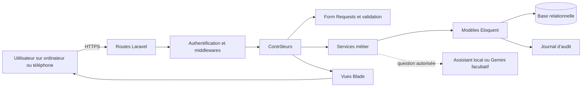
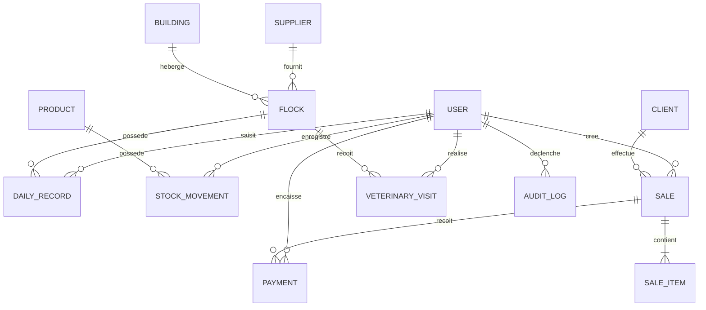
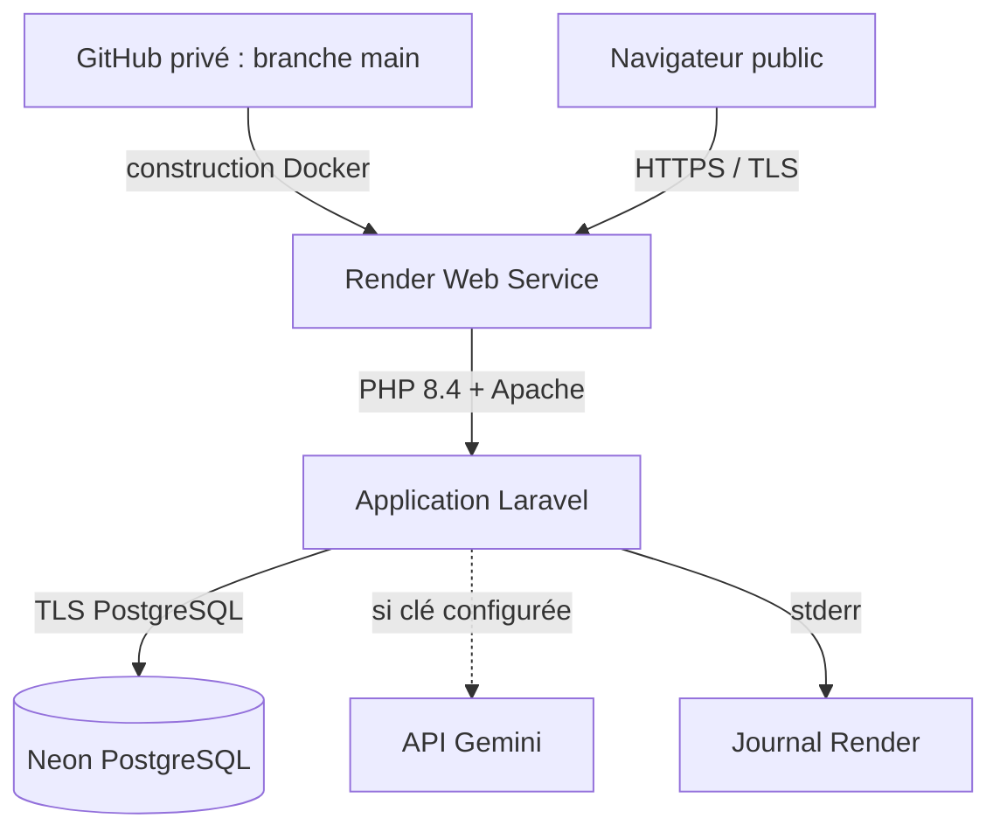

# Technologies et architecture d’ABIWEIN

> État de référence : 24 septembre 2026. Ce document décrit le code réellement présent dans le dépôt. Il ne contient aucun mot de passe, aucune clé API et aucune donnée personnelle.

## 1. Choix d’ensemble

ABIWEIN est une **application web monolithique modulaire**. Le navigateur affiche des pages générées par Laravel ; Laravel applique les droits, les validations et les règles métier ; une base relationnelle conserve les données.

Ce choix est adapté à une exploitation avicole et à une petite équipe : un seul dépôt, un seul déploiement, des transactions cohérentes et une maintenance plus simple qu’un ensemble de microservices. « Monolithique » ne signifie pas désorganisé : les routes, contrôleurs, requêtes, services, modèles et vues restent séparés par responsabilité.



## 2. Logiciels utilisés et justification

### 2.1 Outils de développement

| Logiciel | Version observée/référence | Utilité dans ABIWEIN | Pourquoi ce choix |
|---|---:|---|---|
| Windows + WampServer | environnement du poste | Regroupe Apache, PHP et MySQL pour le développement local | Déjà installé, interface simple et adapté au poste du projet |
| Visual Studio Code | version du poste | Édition du code, navigation entre les fichiers, terminal et Git | Léger, gratuit et très bien pris en charge par PHP/Laravel |
| Git | version du poste | Historique, comparaison et restauration du code | Standard distribué, indispensable pour travailler sans perdre les versions |
| GitHub | dépôt privé `abjnn/ABIWEIN` | Sauvegarde distante et source du déploiement | Dépôt privé, intégration à l’hébergement et historique consultable |
| Codex | outil de développement seulement | Assistance à l’analyse, aux modifications et aux tests | Accélère le développement ; il ne fait pas partie de l’application livrée et n’est pas requis pour l’utiliser |

### 2.2 Serveur et code PHP

| Composant | Version verrouillée | Rôle |
|---|---:|---|
| PHP | 8.4.15 local, `^8.3` minimum | Exécute toute la logique serveur |
| Apache | 2.4.65 local ; image Apache/PHP en production | Reçoit les requêtes HTTP et expose uniquement `public/` |
| Composer | 2.10.x | Installe et verrouille les bibliothèques PHP |
| Laravel | 13.32.0 | Routage, sessions, authentification, validation, Eloquent, migrations, cache et tests |
| Laravel Tinker | 3.0.2 | Diagnostic ponctuel en ligne de commande, jamais exposé aux visiteurs |
| Dompdf | 3.1.6 via `barryvdh/laravel-dompdf` 3.1.2 | Produit les rapports PDF à partir de vues contrôlées |

Laravel a été préféré à du PHP sans framework parce qu’il fournit déjà les protections CSRF, la validation, les sessions, les migrations et les conventions nécessaires. Symfony offrirait une excellente base, mais demanderait davantage d’assemblage pour ce périmètre. Django imposerait Python en plus de la pile PHP disponible. Node/Express nécessiterait de reconstruire davantage de fonctions déjà intégrées à Laravel.

### 2.3 Interface web

| Composant | Version verrouillée | Rôle |
|---|---:|---|
| Blade | fourni par Laravel | Génère les pages HTML côté serveur et crée une vue par écran |
| Bootstrap | 5.3.8 | Grille responsive, formulaires, tableaux, navigation et accessibilité de base |
| Sass | 1.104.1 | Centralise les variables de marque et compile les styles SCSS |
| Vite | 7.3.6 | Compile, minifie et versionne CSS et JavaScript |
| Laravel Vite Plugin | 2.1.0 | Relie Vite aux vues Blade |
| Chart.js | 4.5.1 | Trace les tendances du tableau de bord avec peu de code |
| JavaScript natif | navigateur | Navigation mobile, listes repliables et initialisation des graphiques |
| Axios | 1.20.0 | Disponible pour les requêtes HTTP futures ; les écrans actuels restent principalement serveur |

Blade a été préféré à React ou Vue car ABIWEIN est surtout composé de formulaires, listes, rapports et tableaux de bord protégés. Une application monopage ajouterait deux couches d’état et une API sans bénéfice suffisant aujourd’hui. Bootstrap a été retenu plutôt que Tailwind pour ses composants accessibles et disponibles. Chart.js est plus compact que D3 pour des courbes et barres classiques ; Highcharts introduirait des contraintes de licence inutiles.

### 2.4 Données

| Système | Usage | Pourquoi |
|---|---|---|
| MySQL 8.4.7 | Base locale WampServer | Stable, déjà installé et très bien pris en charge par Laravel |
| PostgreSQL Neon | Base prévue pour l’hébergement gratuit | Données persistantes malgré la mise en veille du serveur et connexion chiffrée |
| SQLite en mémoire | Tests automatisés | Très rapide, isolé et recréé pour chaque scénario PHPUnit |
| Eloquent ORM | Accès aux tables dans le code | Relations lisibles, requêtes paramétrées et portabilité MySQL/PostgreSQL |
| Migrations Laravel | Évolution du schéma | Chaque changement de table est versionné et reproductible |

Une base relationnelle a été préférée à MongoDB : les ventes, paiements, bandes, utilisateurs et mouvements ont des liens forts, des contraintes et des transactions. Des feuilles Excel ne garantiraient ni l’unicité, ni les accès par rôle, ni un historique fiable. Les montants utilisent des colonnes décimales, jamais des nombres flottants.

### 2.5 Tests et qualité

| Composant | Version | Utilité |
|---|---:|---|
| PHPUnit | 12.5.35 | Tests unitaires et fonctionnels |
| Laravel testing | Laravel 13 | Requêtes HTTP simulées, authentification et assertions de base |
| Mockery | 1.6.15 | Doubles de tests lorsque nécessaire |
| Faker | 1.24.1 | Données fictives reproductibles |
| Laravel Pint | 1.32.1 | Formatage homogène du PHP |
| npm/Vite build | Node.js 26.1.0 local | Vérifie que le front-end compile pour la production |

Les tests automatisés ont été préférés à une vérification uniquement manuelle : ils protègent les rôles, les calculs financiers, les stocks, les PDF et les validations lors de chaque modification. Une vérification visuelle reste nécessaire pour le responsive et la qualité graphique.

### 2.6 Assistant d’analyse

L’assistant possède deux modes :

1. un mode local déterministe, toujours disponible et sans coût réseau ;
2. Gemini `gemini-2.5-flash-lite` lorsque `GEMINI_API_KEY` est configurée.

Seuls des indicateurs agrégés sont envoyés au fournisseur externe. Les salutations restent locales afin de répondre naturellement sans consommer l’API. L’assistant ne crée ni vente, ni traitement, ni mouvement et ne remplace jamais le vétérinaire. Le vétérinaire n’a pas accès à ce module. Une API payante n’a pas été imposée parce que le projet demande d’abord un fonctionnement gratuit ; un grand modèle hébergé sur le même serveur consommerait trop de mémoire.

## 3. Architecture logique

### 3.1 Chaîne de traitement d’une requête

1. Une route nommée dans `routes/` reçoit l’URL.
2. Les middlewares contrôlent la session, l’état actif du compte et le rôle.
3. Un `FormRequest` nettoie et valide les données entrantes.
4. Le contrôleur orchestre le cas d’utilisation sans contenir toute la règle métier.
5. Un service applique les opérations complexes et les transactions.
6. Eloquent lit ou écrit les tables avec des requêtes paramétrées.
7. Les observateurs enregistrent les changements sensibles dans le journal d’audit.
8. Une vue Blade présente le résultat ou Laravel renvoie une redirection avec un message.

### 3.2 Couches du projet

| Couche | Emplacement | Responsabilité |
|---|---|---|
| Routage | `routes/*.php` | URLs, noms de routes et restrictions initiales |
| Contrôleurs | `app/Http/Controllers` | Coordination d’une demande utilisateur |
| Validation | `app/Http/Requests`, `app/Rules` | Formats, contraintes et messages d’erreur |
| Autorisation | middlewares, méthodes du modèle `User` | Séparation Administrateur/Responsable/Vétérinaire |
| Métier | `app/Services` | ventes, paiements, alertes, rapports, audit et assistant |
| Domaine | `app/Models`, `app/Enums` | entités, relations, conversions et valeurs permises |
| Persistance | `database/migrations`, `database/seeders` | schéma et scénario fictif |
| Présentation | `resources/views` | pages Blade organisées par module |
| Apparence | `resources/scss` | palette, responsive et composants visuels |
| Interactivité | `resources/js` | graphiques et interactions progressives |
| Vérification | `tests` | comportements, sécurité et intégrité |

### 3.3 Modules fonctionnels

- **Espace public** : accueil, présentation, activités, contact et connexion.
- **Authentification** : connexion, déconnexion, limitation des tentatives et compte actif/bloqué.
- **Administration** : comptes utilisateurs et journal d’audit.
- **Exploitation** : bâtiments, fournisseurs, bandes, affectations, mouvements et relevés quotidiens dans le modèle métier.
- **Stocks** : intrants, quantités, seuils, dates d’expiration et mouvements.
- **Sanitaire** : visites, diagnostics, recommandations et validation d’application par le responsable.
- **Commercial** : clients, ventes de poulets, paiements en espèces et créances.
- **Financier** : dépenses, encaissements, soldes et tendances.
- **Rapports** : instantané administratif archivé et téléchargement PDF.
- **Assistant** : conversation privée pour l’administrateur et le responsable.

### 3.4 Rôles

| Action | Administrateur | Responsable d’exploitation | Vétérinaire |
|---|---:|---:|---:|
| Consulter la synthèse autorisée | Oui | Oui | Oui, technique seulement |
| Gérer les comptes | Oui | Non | Non |
| Consulter audit, ventes, finances et rapports | Oui, lecture | Oui | Non |
| Saisir ventes, paiements, dépenses et stocks | Non | Oui | Non |
| Consulter les visites | Oui | Oui | Oui |
| Rédiger une visite vétérinaire | Non | Non | Oui |
| Confirmer l’application d’une recommandation | Non | Oui | Non |
| Utiliser l’assistant | Oui | Oui | Non |

Le principe est celui du **moindre privilège** : l’administrateur contrôle et observe, le responsable exécute l’exploitation, le vétérinaire intervient dans son domaine sanitaire.

### 3.5 Modèle de données simplifié



Les stocks contiennent les **intrants de la ferme**. Les ventes de poulets sont décrites par leurs lignes de vente et ne diminuent pas un pseudo-stock commercial d’aliments ou de vitamines.

## 4. Architecture physique

### 4.1 Poste local

```text
Navigateur
   │ http://127.0.0.1:8000
   ▼
Serveur PHP intégré de Laravel (`php artisan serve`)
   ├── code : C:\Users\AMBIANA\Documents\ChatGPT\Application ABIWEIN
   ├── ressources Vite compilées dans public/build
   └── connexion locale TCP 3306
          ▼
       MySQL 8.4 fourni par WampServer — base abiwein
```

Le fichier `.env` relie le code au poste local. Il n’est jamais versionné. `vendor/`, `node_modules/` et `public/build/` sont reconstruits à partir des fichiers de verrouillage. Apache WampServer peut aussi servir le dossier `public/` au moyen d’un hôte virtuel, mais l’URL locale `127.0.0.1:8000` utilisée pendant le développement provient bien de `php artisan serve`.

### 4.2 Hébergement cible gratuit



Le `Dockerfile` possède trois étapes :

1. Node compile Vite ;
2. Composer installe les bibliothèques PHP sans dépendances de développement ;
3. PHP 8.4/Apache sert uniquement `public/` avec les extensions PostgreSQL, GD, DOM, Intl, mbstring, cURL, Zip et OPcache.

Au démarrage, `docker/start.sh` met en cache la configuration, exécute les migrations, initialise une base vide lorsque cela est explicitement autorisé, puis lance Apache sur le port fourni par Render. Le service de fichiers Render étant éphémère, aucune donnée métier durable ne doit y être stockée ; la base Neon porte la persistance.

### 4.3 Limites assumées de l’offre gratuite

- Render peut mettre le service en veille : la première ouverture peut être plus lente.
- Neon peut suspendre son calcul inactif puis le réveiller à la première requête ; les données restent stockées.
- Il n’y a pas de haute disponibilité ni d’engagement de service gratuit.
- Les documents PDF sont générés à la demande et transmis directement, pas archivés sur le disque éphémère.
- L’envoi réel du formulaire de contact nécessite un SMTP configuré ; avec `MAIL_MAILER=log`, le message reste dans les journaux.
- L’assistant externe nécessite une clé Gemini ; sans clé, le mode local continue de fonctionner.

Pour une ferme plus grande, la prochaine évolution serait un stockage objet pour les pièces jointes, des sauvegardes vérifiées, un worker de file d’attente et un hébergement sans mise en veille.

## 5. Sécurité

- mots de passe hachés par Laravel ;
- aucune inscription publique ; seul l’administrateur crée les comptes ;
- adresse de connexion unique et mot de passe distinct ;
- protection CSRF sur les mutations ;
- limitation des tentatives de connexion, contact et chat ;
- validation serveur systématique ;
- transactions pour ventes, paiements et mouvements sensibles ;
- contrôles de rôle sur les routes et dans les actions ;
- journalisation des créations, modifications et suppressions sans mot de passe ni jeton ;
- en-têtes CSP, HSTS sous HTTPS, anti-iframe, anti-MIME-sniffing et absence de cache privé ;
- secrets dans les variables d’environnement de l’hébergeur, jamais dans Git ;
- requêtes Eloquent paramétrées contre l’injection SQL.

## 6. Pourquoi pas des microservices ou une application mobile native ?

Les microservices demanderaient plusieurs déploiements, une authentification interservice, des files, une observabilité distribuée et des transactions plus difficiles. ABIWEIN ne possède pas encore le volume ou l’équipe justifiant ce coût.

Une application Android/iOS native demanderait deux chaînes de livraison et une API complète. Le site responsive couvre ordinateur, tablette et téléphone depuis un seul code. Une API pourra être ajoutée plus tard sans réécrire le domaine métier si un véritable besoin hors ligne apparaît.

## 7. Parcours de modification sûr

1. Modifier le schéma par une nouvelle migration ; ne jamais corriger une base existante à la main.
2. Ajouter ou adapter le modèle et l’enum.
3. Écrire la validation dans un `FormRequest`.
4. Placer les règles transactionnelles dans un service.
5. Garder le contrôleur court.
6. Créer une vue Blade dédiée et commenter ses blocs fonctionnels.
7. Ajouter les styles via les variables de `resources/scss/_brand.scss`.
8. Écrire les tests de comportement et de rôle.
9. Exécuter `php artisan test` et `npm run build`.
10. Commiter sans `.env`, mot de passe, export SQL ou donnée réelle.

## 8. Commandes de contrôle

```powershell
php artisan route:list
php artisan migrate:status
php artisan test
composer validate --strict
composer audit
npm run build
git status
```

Cette architecture reste volontairement simple : elle maximise la lisibilité, la sécurité et la possibilité de modifier ABIWEIN sans devoir comprendre plusieurs applications indépendantes.
